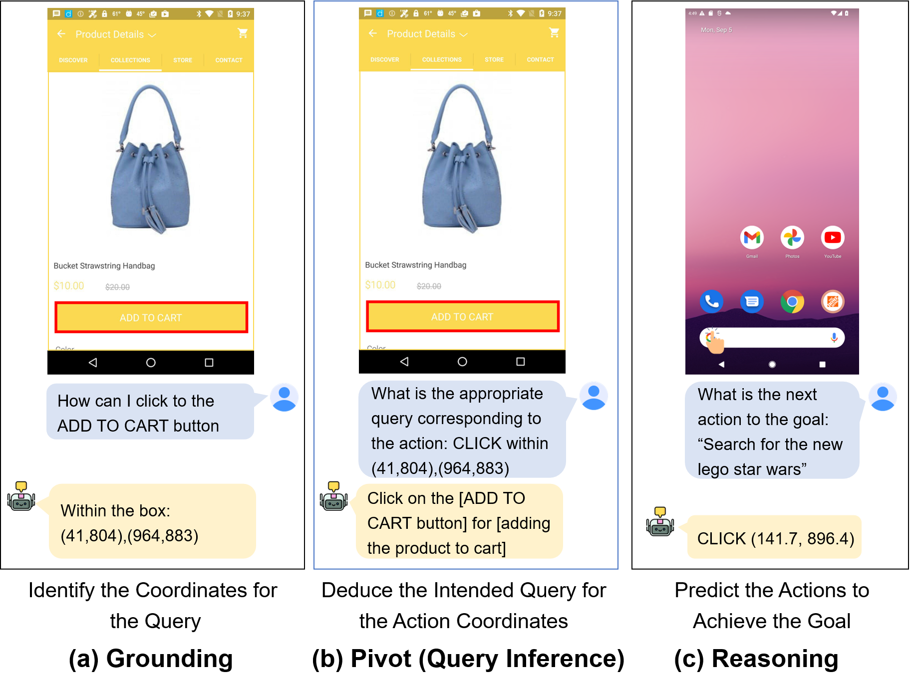
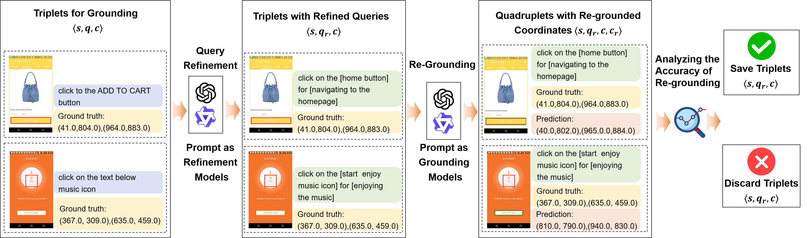
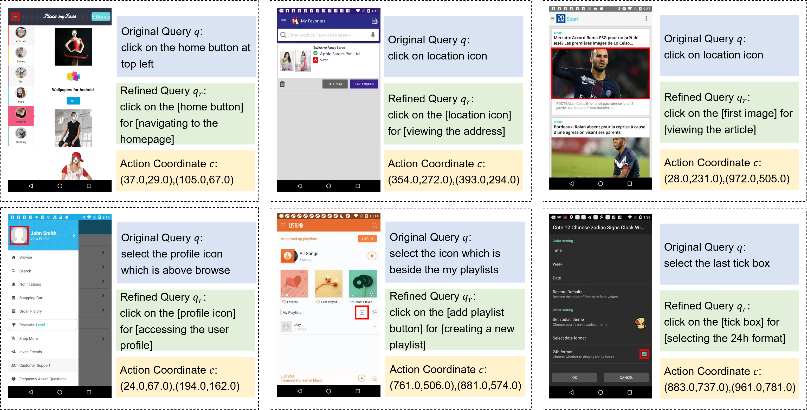

# GUIPivot.Private

<div align="center">
  <h2 align="center">Smoothing Grounding and Reasoning for MLLM-Powered GUI Agents with Query-Oriented Pivot Tasks</h2>
  <a href="https://arxiv.org/abs/2503.00401" style="display: inline-block; text-align: center;">
      
  </a>
</div>

**This repository is the code implementation of our paper:**
```
Smoothing Grounding and Reasoning for MLLM-Powered GUI Agents with Query-Oriented Pivot Tasks
```
We propose a pivot task name **query inference** to smooth coordinate-oriented grounding and action-oriented reasoning, imporoving the performance of MLLM-powered GUI agents in resource-constrained scenarios.
<div align="center">
  <a style="display: inline-block; text-align: center;">
      
  </a>
</div>


## 🆙 Updates
* [x] We have released the code for data preprocessing, query refinement, and evaluation.
* [x] We have released the training data in sharegpt format.

## Dependencies
- The training for grounding, query inference, and reasoning is based on [LLaMA-Factory](https://github.com/hiyouga/LLaMA-Factory). Please refer to the LLaMA-Factory repo for installation instructions for the training environment.
- After setting up LLaMA-Factory for training, install additional requirements by running:
```bash
    pip3 install -r requirements.txt
```

## Training Data
- We have released the JSON training data in LLaMA-Factory-supported sharegpt format, along with [dataset_info.json](./data/dataset_info.json) for LLaMA-Factory training in the [./data/] directory. Please unzip [./data/GUI.zip](./data/GUI.zip) using the following commands to obtain the JSON data. The UIBERT dataset for query inference is also provided in [./data/GUI/uibert_query_summary_polished_preprocessed_train.json](./data/GUI/uibert_query_summary_polished_preprocessed_train.json)
```bash
    zip -s 0 GUI.zip --out combined.zip
    unzip combined.zip
```
- The original datasets can be downloaded as follows:
  - **UIBERT**: UIBERT is a subset of the [OS-Atlas](https://hf-mirror.com/datasets/OS-Copilot/OS-Atlas-data) grounding dataset. Refer to the above link for downloading.
  - **AITZ**: [AITZ](https://github.com/IMNearth/CoAT) is a mobile agent dataset derived from a subset of AITW and annotated by proprietary MLLMs for CoAT components. Refer to the above link for downloading.
  - **AndroidControl**: [AndroidControl](https://github.com/google-research/google-research/tree/master/android_control) is a mobile agent dataset comprising 15,283 demonstrations with step-by-step instructions. Refer to the above link for downloading the TFRecord file and extracting the image files.
  
- After downloading the original datasets, adjust the folder structure as follows:
  - **UIBERT**: Move all images to [./GUIData/UIBert/screenshots](./GUIData/UIBert/screenshots).
  - **AITZ**: Move all images to [./GUIData/android_in_the_zoo/train/images](./GUIData/android_in_the_zoo/train/images) and [./GUIData/android_in_the_zoo/test/images](./GUIData/android_in_the_zoo/test/images) according to the original split setting.
  - **AndroidControl**: Move the original dataset to [./GUIData/android_control_parsed](./GUIData/android_control_parsed) and run the following command for processing.
```bash
    python mergeAndroidControl.py
```
- After adjusting the folder structure, it should look like this:
```
.
└── GUIData
    ├── UIBert
    │   ├── screenshots
    │   │   └── image_files
    │   └── uibert_raw.json
    ├── android_control
    │   ├── images
    │   │   └── image_files
    │   ├── jsons
    │   │   └── json_files
    │   └── layouts
    │       └── accessibility_tree_files
    └── android_in_the_zoo
        ├── test
        │   ├── images
        │   │   └── image_files
        │   └── jsons
        │       └── json_files
        └── train
            ├── images
            │   └── image_files
            └── jsons
                └── json_files
```

## Constructing Dataset for Query Inference

<div align="center">
  <a style="display: inline-block; text-align: center;">
      
  </a>
</div>


We provide the code implementation for constructing UIBERT for query inference. The detailed process is as follows:

1. Prepare the original UIBERT dataset and adjust the folder structure as mentioned above.
2. Configure the API key for **Qwen-VL-Max** in [refineQuery.py](refineQuery.py):
```python
client = OpenAI(
    api_key="your key", 
    base_url="https://dashscope.aliyuncs.com/compatible-mode/v1",
)
```
3. Run `python refineQuery.py` to construct the refined dataset. The results will be saved at [./data/GUI/uibert_query_summary_polished_preprocessed.json](./data/GUI/uibert_query_summary_polished_preprocessed.json). 

Example triplets $\langle s, q_r, c \rangle$ from the refined UIBERT dataset, along with the original query $q$ are provided as follows:
<div align="center">
  <a style="display: inline-block; text-align: center;">
      
  </a>
</div>

## Construct JSON Datasets in Sharegpt Format
- For constructing AITZ, run `python preprocessAITZActionPredictAblations.py`. The results will be saved at `./data/GUI/aitz_ablation_[1-10]_action_predict_test.json` and `./data/GUI/aitz_ablation_[1-10]_action_predict_train.json`. For the meaning of the ID in the filenames, please refer to our paper.
- For constructing AndroidControl, run `python preprocessAndroidControlActionPredictHigh.py` and `python preprocessAndroidControlActionPredictLow.py`. The results will be saved at `./data/GUI/android_control_[high/low]_action_predict_test.json` and `./data/GUI/android_control_[high/low]_action_predict_train.json`. 

All JSON datasets ending in `train` will be used for training, and those ending in `test` will be used for evaluation.

## Evaluation
After acquiring the fine-tuned model for reasoning, configure and run `evaluate.py` to obtain the evaluation results on two mobile agnet benchmarks.

Detailed arguments setting:
```bash
python evaluate.py \
    --type [acactioneval for AndroidControl, aitzablationactioneval for AITZ] \
    --testJsonPath [the path to the test split JSON dataset] \
    --log [the path to save the result record] \
    --modelPath [the path to the fine-tuned transformer model for reasoning]
```
For the detailed implementation of the evaluation, refer to [./eval/EvalAgentAction.py](./eval/EvalAgentAction.py).

# Acknowledgement
This work can not be done without the help of the following repos:
- LLaMA-Factory: [https://github.com/hiyouga/LLaMA-Factory](https://github.com/hiyouga/LLaMA-Factory)
- flash-attn: [https://github.com/Dao-AILab/flash-attention](https://github.com/Dao-AILab/flash-attention)


# Citation

```ruby
@article{wu2025smoothing,
  title={Smoothing Grounding and Reasoning for MLLM-Powered GUI Agents with Query-Oriented Pivot Tasks},
  author={Wu, Zongru and Cheng, Pengzhou and Wu, Zheng and Ju, Tianjie and Zhang, Zhuosheng and Liu, Gongshen},
  journal={arXiv preprint arXiv:2503.00401},
  year={2025}
}
```
